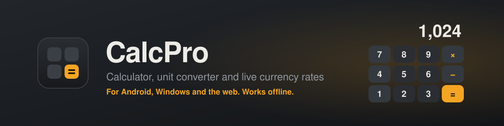
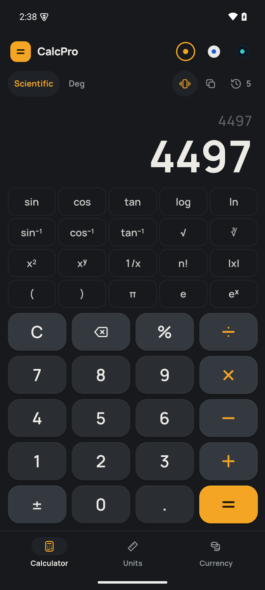
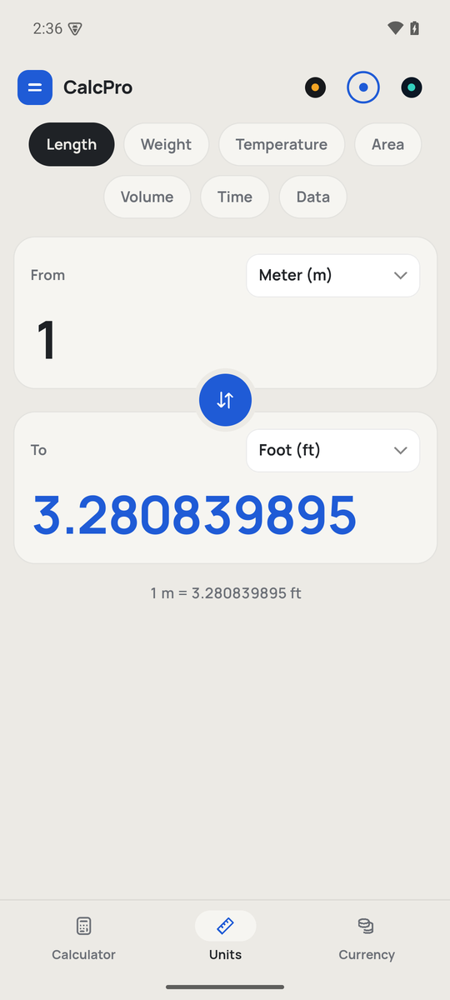
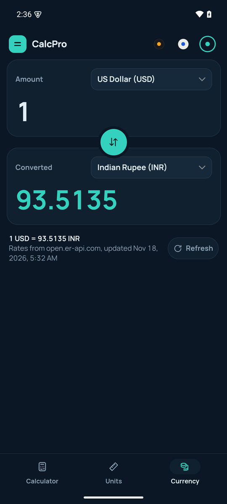
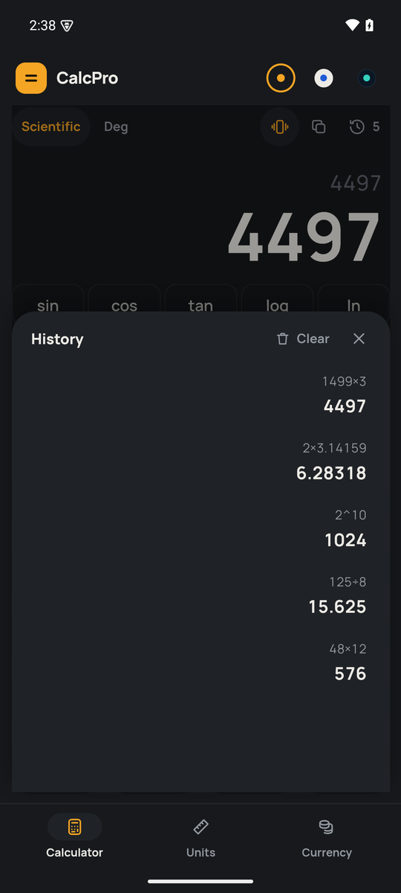
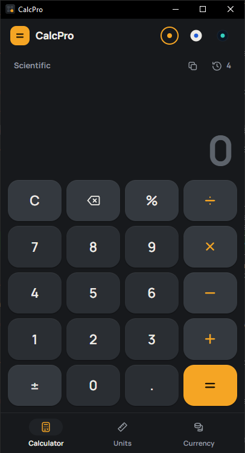
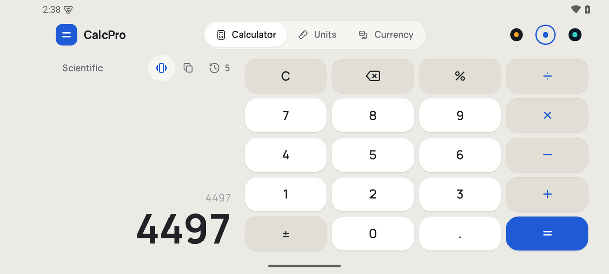
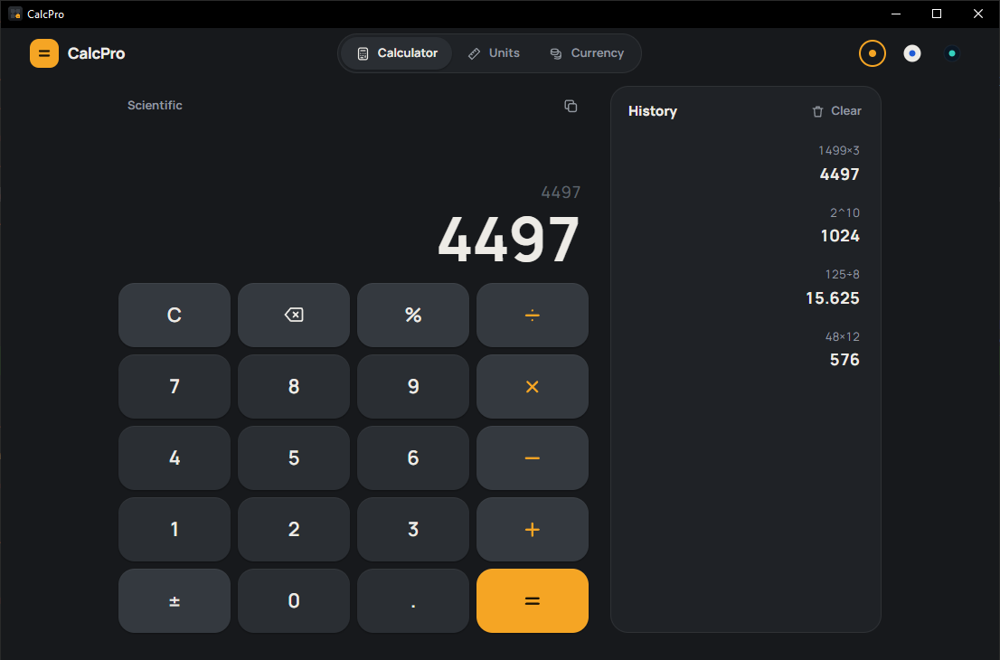
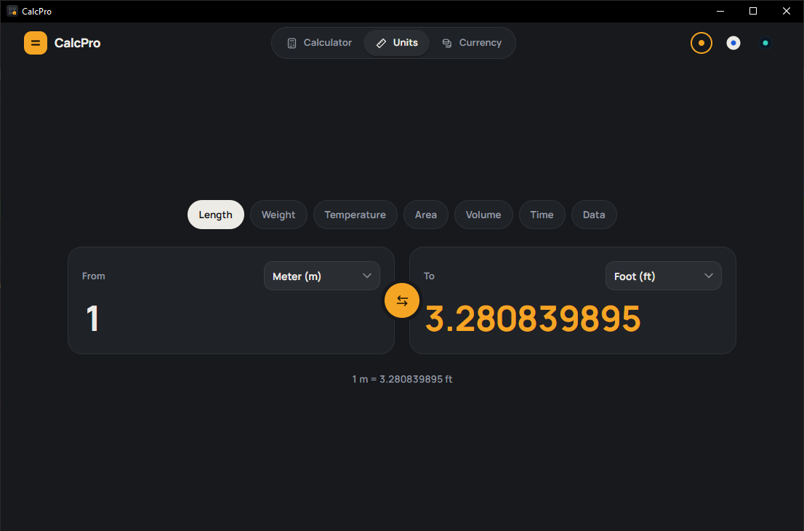

<p align="center">
  
</p>

<h1 align="center">CalcPro</h1>

<p align="center">
  <b>A calculator, unit converter and live currency converter for Android, Windows and the web.</b><br>
  Works offline. The only thing it ever downloads is today's exchange rates.
</p>

<p align="center">
  <a href="https://github.com/AnshuvaGitrepo/calcpro/releases/latest"></a>
  
  
  
  
  <a href="LICENSE"></a>
</p>

<p align="center">
  
  &nbsp;
  
  &nbsp;
  
</p>

---

## Download

| Platform | File | Notes |
| --- | --- | --- |
| **Android 7.0 or newer** | [`CalcPro-1.0.2.apk`](https://github.com/AnshuvaGitrepo/calcpro/releases/latest) | Signed release build. Allow "install unknown apps" for your browser or file manager. |
| **Windows 10/11** (64-bit) | [`CalcPro-Setup-1.0.2.exe`](https://github.com/AnshuvaGitrepo/calcpro/releases/latest) | Installer with Start menu and desktop shortcuts. |
| **Windows 10/11** (64-bit) | [`CalcPro-1.0.2-portable.exe`](https://github.com/AnshuvaGitrepo/calcpro/releases/latest) | Runs without installing. |

Each release also carries `SHA256SUMS.txt` to check the downloads.

## Features

**Calculator**
- Standard and scientific keys: trig in degrees or radians, inverse trig, powers, roots, logs, factorial, absolute value, π and e.
- Live preview while you type, and percentages that work like a desk calculator (200 − 10% = 180).
- History that survives restarts. Tap an entry to use its result again.
- Clear messages instead of "Error" ("Can't divide by 0"), and scientific notation for very large numbers.
- Copy the result, haptic feedback on phones, full keyboard input on desktop (Enter, Esc, Backspace, `p` for π).
- A safe expression parser: input is never run as code.

**Unit converter**
- Length, weight, temperature, area, volume, time and data, converted both ways: edit either side.
- Useful starting pairs (metres to feet, kilograms to pounds, Celsius to Fahrenheit ...).

**Currency**
- 20 currencies with live rates from open.er-api.com.
- Offline it uses the last rates it downloaded, or built-in approximate rates, and says so on screen.

**Made for every screen**
- Three themes: Graphite (amber), Paper (ink blue) and Ocean (sea-glass teal).
- Small phones, phones turned sideways, tablets and desktop windows of any size each get their own layout.
- Android: system bars follow the theme (Android 15 included); Back closes the history sheet, then returns to the calculator, then exits.
- Windows: the app remembers its window size and position.

<table>
  <tr>
    <td align="center"><br><sub>History sheet</sub></td>
    <td align="center"><br><sub>Windows app, default size</sub></td>
  </tr>
  <tr>
    <td align="center" colspan="2"><br><sub>Phone turned sideways: display beside a full-height keypad</sub></td>
  </tr>
  <tr>
    <td align="center"><br><sub>Wide window: history beside the keypad</sub></td>
    <td align="center"><br><sub>Unit converter on a wide window</sub></td>
  </tr>
</table>

## Install

**Android**
1. Download `CalcPro-1.0.2.apk` on the phone.
2. Open it and allow your browser or file manager to install unknown apps when asked.
3. Later versions install over this one and keep your history and settings.

**Windows**
1. Download `CalcPro-Setup-1.0.2.exe` (installer) or `CalcPro-1.0.2-portable.exe` (no install).
2. The files are not code-signed, so SmartScreen shows "Windows protected your PC" the first time: choose **More info**, then **Run anyway**.

**Web**
Build it (below) and serve `dist/` from any static host. It installs as an app from the browser and works offline.

## Build from source

Requires Node.js 20+. The Android build also needs JDK 21 and the Android SDK; Windows builds run on Windows.

```
npm install
npm run dev            # development server on http://localhost:5173
npm test               # calculator engine tests (51 cases)
npm run lint
npm run build          # web build in dist/

npm run electron       # run the Windows app locally
npm run dist:win       # Windows installer + portable exe in release/

npm run android:sync   # copy the web build into the Android project
cd android && gradlew assembleRelease   # APK in android/app/build/outputs/apk/release/
```

Release APKs are signed with a key kept outside the repository (`keys/keystore.properties`). Without it the build produces an unsigned APK. Android only installs an update over an existing copy when both are signed with the same key.

Icons for every platform come from `scripts/make-icons.py` (Python + Pillow): `python scripts/make-icons.py` for web and Windows, `python scripts/make-icons.py android` for Android.

## Project layout

| Path | What it is |
| --- | --- |
| `src/App.jsx` | The whole interface: header, tabs, calculator, unit and currency panels |
| `src/icons.jsx` | Stroke icon set |
| `src/utils/calcEngine.js` | Expression parser and evaluator (no `eval`) |
| `src/utils/converters.js` | Unit definitions |
| `src/utils/currency.js` | Rates download, offline cache and fallback rates |
| `src/index.css` | Themes and component styles |
| `electron/main.cjs` | Windows app shell (sandboxed, private `app://` scheme) |
| `android/` | Capacitor Android project, including a small native plugin for theme-coloured system bars |
| `public/` | PWA manifest, service worker, icons |
| `scripts/` | Icon generator and an Android 15 emulator launcher |
| `docs/` | Banner and screenshots |

## Testing

- `npm test`: 51 engine cases (arithmetic, precedence, percentages, trig, factorial, error messages, large numbers).
- Android 15 (Pixel 7 emulator): portrait, landscape, small-phone landscape, all three themes, keyboard input, 130 % system font, back button, offline mode, restart and upgrade over the previous version.
- Android 11 emulator (older WebView) and Windows 10 at 420, 780 and 1280 px window widths.
- Not yet tested on a physical phone.

## Privacy and security

- No accounts, no analytics, no ads. History and settings stay on the device.
- The only network request is the exchange-rate download from open.er-api.com.
- The built app runs under a strict Content Security Policy that allows only that one address.
- The Windows app is sandboxed and cannot open other windows or navigate away.

## Version history

| Version | Changes |
| --- | --- |
| 1.0.2 | Landscape phones: display beside a full-height keypad, history as a slide-up sheet, compact header on small phones. A value picked from history now shows in the large display. |
| 1.0.1 | Desktop and tablet windows: unit types wrap instead of being cut off, tabs move to the header, history panel beside the keypad, converter cards side by side. Window size remembered. Android 15: themed status and navigation bars, dark launch screen, back button support. |
| 1.0.0 | New design and themes, Android and Windows apps, saved history, clearer error messages, scientific notation for very large numbers. |

## License

[MIT](LICENSE) © 2026 AnshuvaGitrepo

<p align="center">
  <br>
  <sub>Prepared by Anshuva Samanta</sub>
</p>
